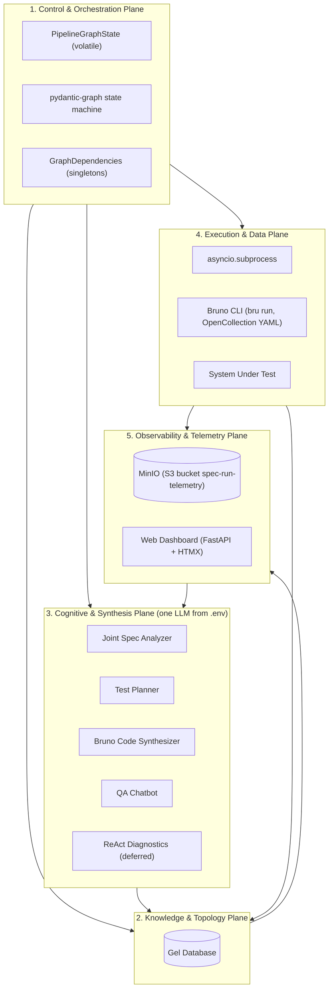
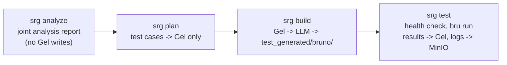
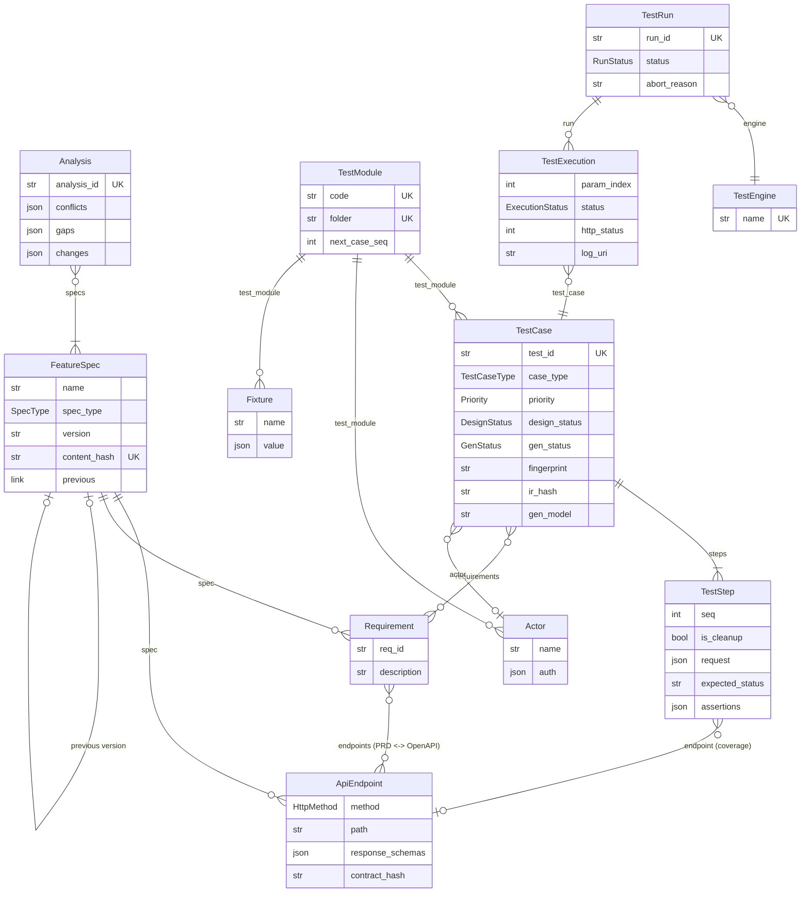
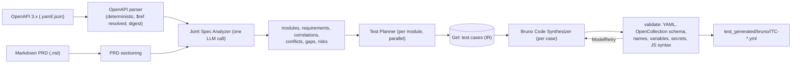

# SpecRunGraph: Architecture & Storage Specification

This document is the technical blueprint of **SpecRunGraph**. It covers the 5-plane separation of concerns, the Gel Knowledge Plane schema, the MinIO raw-telemetry tier, and the staged pipeline that turns specifications into executed Bruno API tests.

> **Iteration 1 scope:** a local CLI (`srg`), API (HTTP) tests only, the Bruno engine (OpenCollection YAML), Gel and MinIO in Docker, LLMs from OpenCode Go, and a local web dashboard with a QA chatbot. ReAct failure triage (§4) is designed but deferred.

---

## 1. The 5-Plane Architectural Model



| Plane | Core technology | Primary responsibility | Storage invariant |
| :--- | :--- | :--- | :--- |
| **Control** | `pydantic-graph` | Routes each CLI verb through the stage nodes; error boundaries | Volatile `PipelineGraphState`; anything durable is in Gel, MinIO or on disk, so every stage can start from persisted artifacts |
| **Knowledge** | Gel | Specs, endpoints, requirements, analyses, test cases, runs | Specs and analyses are append-only and versioned. Test cases, runs and executions are mutable |
| **Cognitive** | `PydanticAI` (OpenCode Go model from `.env`) | Joint analysis, test design, Bruno implementation, Q&A | Stateless agent calls; every output is validated deterministically and retried with `ModelRetry` |
| **Execution** | Bruno CLI, `asyncio.subprocess` | Runs the generated collection against the SUT | Ephemeral OS processes (own process group, timeout kill) |
| **Observability** | MinIO, Gel, FastAPI | Raw logs and reports; dashboard and chatbot (read-only) | Two tiers: raw logs in S3, structured metadata in Gel |

**Every LLM step uses the single model configured in `.env`:** `SRG_MODEL`, served at `OPENCODE_BASE_URL` (OpenAI-compatible chat completions) with `OPENCODE_API_KEY`. The steps that use it are:
- joint spec analysis;
- test-case generation into Gel;
- implementing the cases as Bruno files;
- the chatbot.

Deterministic code does everything else:
- parsing the specs;
- persistence;
- collection scaffolding;
- validation of LLM output;
- running `bru`.

### Pipeline (CLI verbs)



`srg go` runs all four stages. `srg cases` / `srg show` review what is in Gel, `srg reset` wipes Gel and the bucket, and `srg web` starts the dashboard.

---

## 2. Gel Knowledge Plane Schema

The schema lives in `dbschema/default.gel`. It is applied by `srg doctor` through the Python client (`start migration to {...}`), so no Gel CLI is needed. `GET`, `POST`, … and `module` are reserved words in Gel: the HTTP-method enum labels are back-quoted, and the link to a module is called `test_module`.



### Type definitions
- **`SpecType`**: `OPENAPI`, `REQUIREMENTS_DOC`. AsyncAPI, GraphQL and Protobuf come later behind the `SpecLoader` interface.
- **`TestCaseType`**: `POSITIVE`, `NEGATIVE`, `BOUNDARY`, `SECURITY`, `RBAC`. This is a property of the test case, not of the requirement.
- **`DesignStatus`** (human review): `DRAFT`, `READY`, `NEEDS_REVIEW` (set by spec-change impact), `DEPRECATED`.
- **`GenStatus`** (Bruno implementation): `PENDING`, `GENERATED`, `FAILED_GEN`.
- **`RunStatus`**: `PENDING`, `RUNNING`, `COMPLETED`, `ABORTED`.
- **`ExecutionStatus`**: `PASSED`, `FAILED`, `ERROR`, `TIMEOUT`, `SKIPPED`.

### Key rules
- **Coverage is computed:** `TestCase.endpoints := distinct .steps.endpoint`.
- **Test ids are assigned by code, never by the LLM.** Ids follow `TC-<MODULE>-NNN` and come from `TestModule.next_case_seq` in the insert transaction. They are never reused.
- **Re-planning fills gaps.** The planner receives the existing cases, and a deterministic `fingerprint` (module, endpoints, type, normalized title) drops duplicates.
- **Spec change impact.** A new version of a spec gets a `previous` link. Endpoints are diffed by `contract_hash`, and requirements by a hash of their description. Test steps and requirement links are re-pointed to the new version. Affected cases become `NEEDS_REVIEW` with a `review_reason`, and `srg build` skips them until they are approved.

---

## 3. Two-Tier Storage Topology

```text
┌─────────────────────────────────────────────────────────────┐
│                       Test Execution                        │
└──────────────────────────────┬──────────────────────────────┘
                               │
            ┌──────────────────┴───────────────────┐
            ▼                                      ▼
┌────────────────────────────┐        ┌────────────────────────────┐
│      Knowledge Tier        │        │     Raw Telemetry Tier     │
│          (Gel)             │        │       (MinIO / S3)         │
├────────────────────────────┤        ├────────────────────────────┤
│ • Run status & timestamps  │        │ • bru stdout / stderr      │
│ • HTTP status & durations  │        │ • results.json / .xml      │
│ • Failed assertions        │        │ • per-case report.json     │
│ • S3 URI pointers          │        │   (request/response dumps) │
└────────────────────────────┘        └────────────────────────────┘
```

- **S3 bucket:** `spec-run-telemetry`. It is created on demand. The image is `pgsty/minio`, because official MinIO images are no longer published on Docker Hub.
- **Run-level keys:** `runs/<run_id>/{bru.stdout, bru.stderr, results.json, results.xml}`.
- **Per-case keys:** `runs/<run_id>/<test_id>/<param_index>/report.json`. An `<attempt>/` level is added once reruns exist.
- **Metadata pointers:** `TestRun.log_prefix_uri` and `TestExecution.log_uri` hold `s3://spec-run-telemetry/...`.
- **Secrets never reach storage.** They are passed to `bru` only as process environment variables (`{{process.env.X}}`), and Bruno masks `Authorization` in its reports.

---

## 4. ReAct Diagnostics State Machine (deferred)

When this is built, failed executions will go to a `DiagnosticsNode`:
1. A **deterministic pre-classifier** maps connection refused, 502/503 and timeouts to `ENV_FAILURE` without an LLM call. The pre-flight health check already aborts a run early when the SUT is down.
2. The PydanticAI agent then reads the telemetry from both tiers, through the tools `get_logs`, `get_spec_fragment`, `get_requirement`, `get_script` and `rerun_test`.
3. It classifies each failure as one of: `APPLICATION_BUG`, `SPEC_MISMATCH`, `ENV_FAILURE`, `FLAKY` (needs a rerun policy), `TEST_DEFECT` (the generated test is wrong; the case goes back to `PENDING`), or `UNKNOWN` (when confidence is below the threshold).
4. The result is persisted as a `DiagnosticNote`, linked exclusively to its `TestExecution`. These Gel types are added by a migration in that iteration.

---

## 5. Joint Ingestion, Test Design & Implementation



- **The analyzer sees all specs at once.** Beyond requirements, it reports **conflicts** between documents (e.g. the PRD caps the quantity at 50 while OpenAPI caps it at 100) and **gaps** (e.g. a requirement with no endpoint).
- **The test-case IR is the team's reference format,** with these fixes:
  - a `$var` namespace;
  - explicit `response.body…` paths;
  - a small check grammar;
  - `requirement_refs` as a list;
  - defined `actors` and `fixtures`;
  - named parameter rows;
  - cleanup in step form;
  - `expected_error` folded into assertions.
- **Bruno layout** is flat, one folder per module:
  - `TC-ORD-003.yml` for a single-step case;
  - `TC-ORD-005a-<row>.yml` for each parameter row;
  - `TC-ORD-009-stepN-<step>.yml` for each workflow step.

  A manifest (`test_generated/.srg-bruno-manifest.json`) maps the files back to cases and rows.
- **Incremental builds:** a case whose IR is unchanged (`ir_hash`) is not regenerated. `--force` regenerates it anyway.
